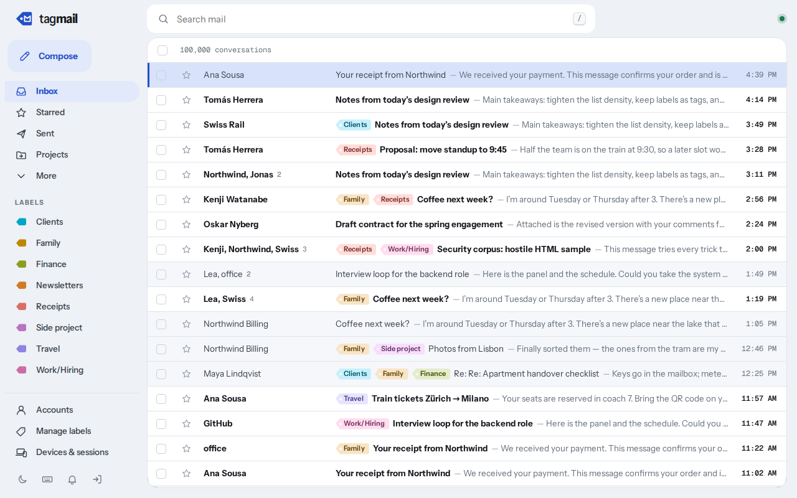
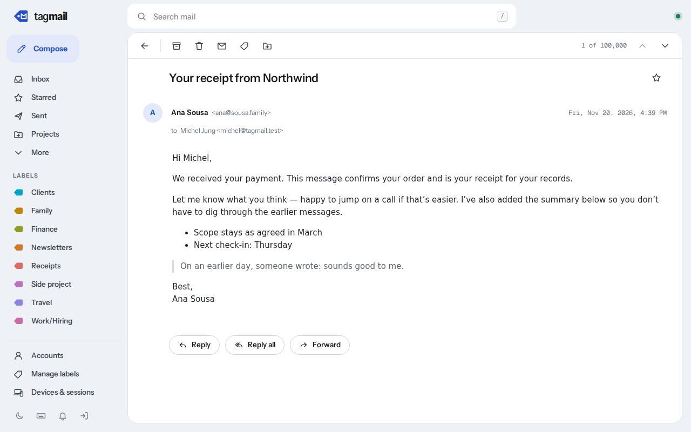
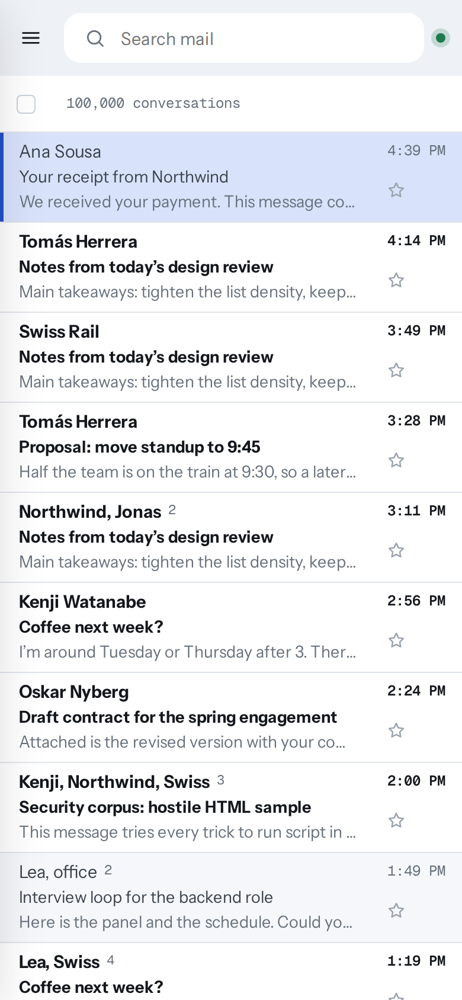

# Tagmail

Tagmail is a self-hosted, single-user email client with a Gmail-like
interface for any IMAP server. A small Rust server syncs your accounts and
serves one web app, which also runs as a desktop app (Linux, Windows,
macOS) and as an installable PWA on phones.



## Status

Feature-complete toward 1.0 and in testing. Known gaps:

- The desktop installers are not signed; the system warns on first start
  ([install steps](docs/install.md#desktop-app)).
- Tested against Dovecot and Stalwart. Gmail and Fastmail are expected to
  work but have not been probed yet ([servers.md](docs/servers.md)).
- Outlook.com and Microsoft 365 are not supported: they turned off
  password login and Tagmail has no OAuth2 yet.

## Features

- Conversations across folders, including Sent
- Labels stored as IMAP keywords: other clients see them, and they
  survive a cache rebuild
- Archive, star, read/unread, move, delete and Gmail
  [keyboard shortcuts](docs/shortcuts.md)
- Search with `from:`, `to:`, `subject:`, `label:`, `in:`, `is:`,
  `has:attachment`, `before:`, `after:`, quotes, `OR` and negation, over a
  local full-text index
- Virtualized lists that stay fast with 100,000 conversations
- Multiple accounts with a unified inbox, identities and signatures;
  replies go out from the address the mail was sent to
- Compose, reply, reply all, forward and attachments; drafts saved to
  IMAP Drafts; a durable outbox
- HTML mail rendered sanitized and sandboxed; remote images blocked until
  you allow them, then loaded through the server
- Owner login with password or passkeys; account passwords encrypted at
  rest
- Desktop app: offline reading, search and compose, native notifications,
  unread count in the tray, `mailto:` handler
- PWA: phone layout, swipe to archive, push notifications for new mail
- Docker image and NixOS module

Out of scope for 1.0: native mobile apps, filters, snooze, undo send,
multiple users, JMAP, Gmail API labels and OAuth2.

| Conversation | Phone |
|---|---|
|  |  |

## Quick start

With Docker Compose, from a copy of
[`deploy/docker/docker-compose.example.yml`](deploy/docker/docker-compose.example.yml):

```sh
openssl rand -hex 32 > master.key
sudo chown 65532:65532 master.key && sudo chmod 400 master.key
docker compose up -d
docker compose logs tagmail | grep "setup token"
```

Put a TLS reverse proxy in front, open your address, and enter the setup
token with a new owner password. The full steps, including the public
origin the server needs, are in
[deploy/docker/README.md](deploy/docker/README.md).

## Documentation

- [Install](docs/install.md): Docker, NixOS, release archives, reverse
  proxy, first start, desktop app, PWA
- [Backup and restore](docs/backup.md)
- [IMAP servers](docs/servers.md): Gmail, Fastmail, Dovecot, Stalwart,
  and how to probe yours
- [Security model](docs/security.md)
- [Architecture](docs/architecture.md)
- [Keyboard shortcuts and search](docs/shortcuts.md)
- [Web app install and notifications](docs/pwa.md)
- [Docker](deploy/docker/README.md) and [Nix](deploy/nix/README.md)

## Architecture

```
 IMAP / SMTP servers
        │
 ┌──────┴─────────────────────────────┐
 │ tagmail-server (Rust)              │
 │  engine: sync, threading, labels   │
 │  store:  SQLite + FTS5, blob cache │
 │  api:    HTTP + server-sent events │
 └──────┬─────────────────────────────┘
        │
 ┌──────┴──────┬───────────────┬─────────────┐
 │ Web app     │ Desktop       │ PWA         │
 │ (SvelteKit) │ (Tauri 2,     │ (SvelteKit, │
 │             │ local replica)│ Web Push)   │
 └─────────────┴───────────────┴─────────────┘
```

IMAP is the source of truth. The server's cache and search index are
disposable and rebuild from IMAP. Details in
[docs/architecture.md](docs/architecture.md).

## Contributing

See [CONTRIBUTING.md](CONTRIBUTING.md). To report a vulnerability, see
[SECURITY.md](SECURITY.md).

## License

Tagmail is licensed under the
[GNU Affero General Public License v3.0](LICENSE).
